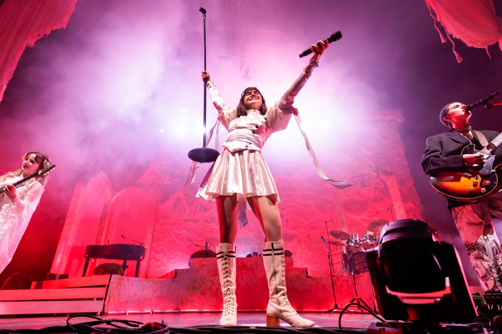
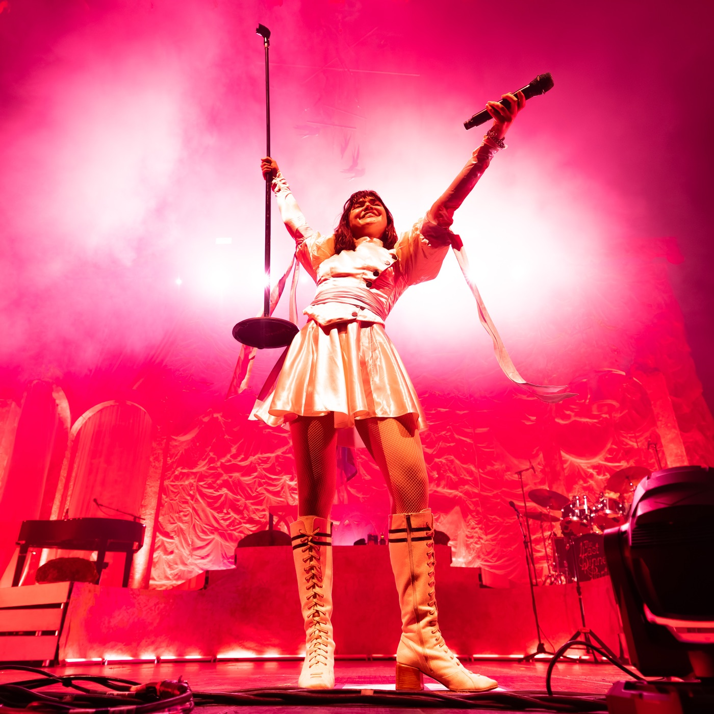

# Stage Fix v6

**A free Lightroom preset system for concert, festival, club and event photos shot in difficult stage light.**

15 folders, 90 working presets and 15 reset presets, for Lightroom Classic and Adobe Camera Raw. It was built in concert pits, across thousands of real delivery edits where the light was green, the spots were clipping and the deadline was that evening. It used to be a paid product; now it's free.

| Before | After |
| --- | --- |
|  |  |
|  |  |

## The system: correct, stabilize, finish

One preset is rarely enough when the light is actually difficult, so Stage Fix works in steps. You don't need every folder on every photo. Treat it like a checklist: fix only what the frame needs, then stop.

1. **Correct.** Fix white balance, colour casts and ugly mixed light first. Get the file to neutral before you do anything creative.
2. **Stabilize.** Recover highlights, control noise and bring the file back into shape. Fix the technical problems before you add style.
3. **Finish.** Add the final look once the image is technically under control: your own style, or one of the included finishing presets.

The folders appear in this order after import:

| Folder | What it does |
| --- | --- |
| SF - 01 White Balance | 10 steps cooler/greener and 10 steps warmer/more magenta |
| SF - 02 Base | Base corrections from Soundcheck (small) to Finale (big) |
| SF - 03 Red Fix | Red stage light, from a light gel to "Alarm" |
| SF - 04 Green Fix | Green light and LED spill, from light spill to "Nuclear" |
| SF - 05 Purple-UV Fix | Purple and UV light, from haze to "Beam Killer" |
| SF - 06 Blue Fix | Blue and cyan light, from "Light Ice" to "Arctic" |
| SF - 07 Noise Fix | Noise reduction, from "Whisper" to "Emergency" |
| SF - 08 Detail Fix | Detail and sharpening |
| SF - 09 Highlights Fix | Recovering bright spots and highlights |
| SF - 10 to 15 Finish | Black and White, Analogue, Clean, Moody, Soft, Matte |

Every folder has a **Reset** preset at the top, which undoes that folder's step cleanly.

## Install

**From Terminal** (Mac), in one line. Restart Lightroom Classic or Photoshop afterwards; the presets appear as the `SF - ...` folders:

```sh
curl -fsSL https://github.com/woutervellekooppixel/stage-fix/releases/latest/download/Stage-Fix-v6.zip -o /tmp/Stage-Fix-v6.zip && ditto -x -k /tmp/Stage-Fix-v6.zip "$HOME/Library/Application Support/Adobe"
```

**Or by hand:**

1. Download `Stage-Fix-v6.zip` from [Releases](../../releases/latest).
2. **Lightroom Classic:** in the Develop module, click **+** in the Presets panel, choose **Import Presets** and pick the zip.
3. **Adobe Camera Raw:** in the Presets panel, click the **...** menu, choose **Import Profiles & Presets** and pick the zip.

Lightroom (the cloud version) imports the zip via File > Import Profiles and Presets. You can also copy the `SF - ...` folders from `CameraRaw/Settings` in this repository into `~/Library/Application Support/Adobe/CameraRaw/Settings` on a Mac.

## Works well with

Stage Fix gives you a technical base, and your own creative presets go on top. For culling and captioning before you edit, see [Pitpick](https://github.com/woutervellekooppixel/pitpick).

## Credits and license

Made by [Wouter Vellekoop](https://wouter.photo), concert and event photographer.

The presets are licensed under [Creative Commons Attribution 4.0 (CC BY 4.0)](https://creativecommons.org/licenses/by/4.0/). Use them, share them, change them, also commercially: just credit Wouter Vellekoop. The before and after photos in `docs/` are mine and are not covered by this license.
